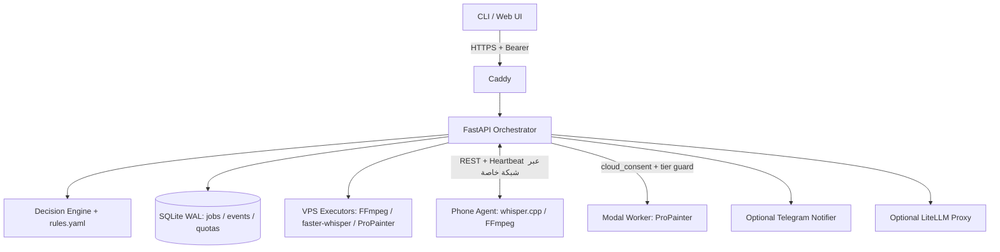
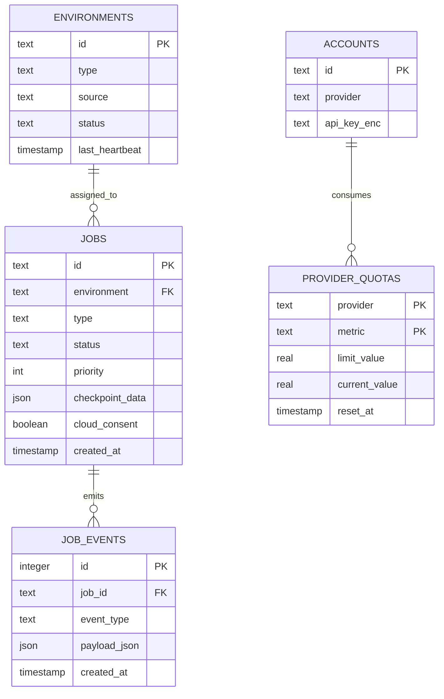
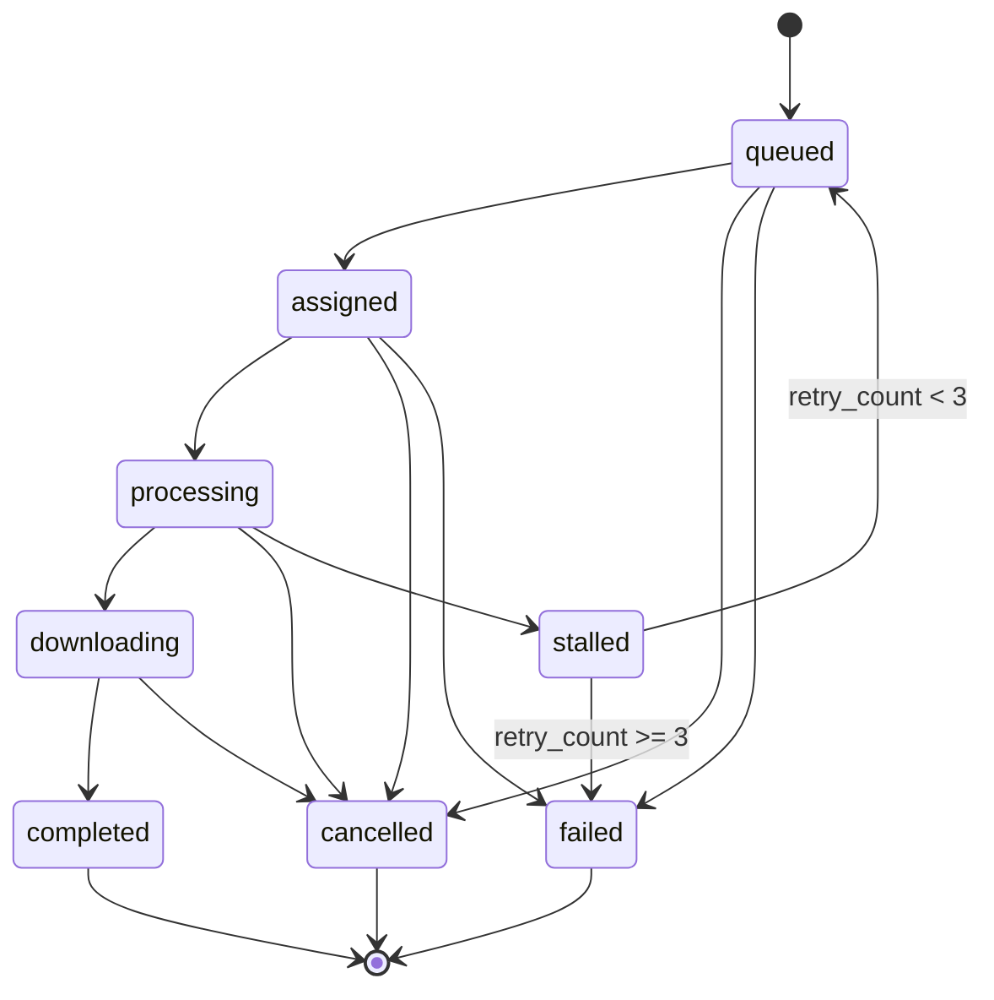
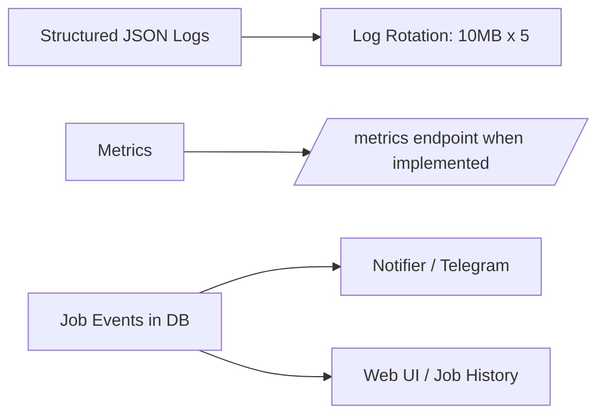
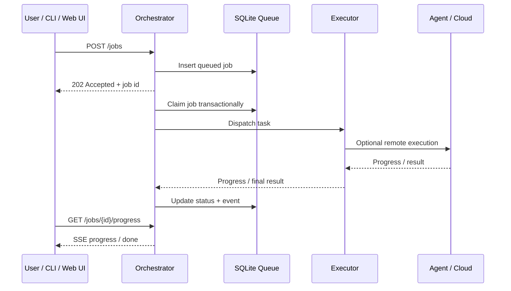
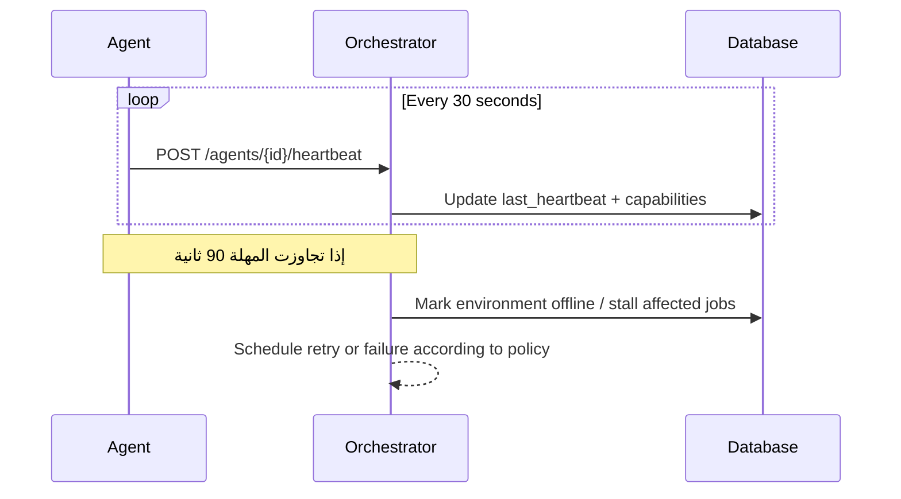
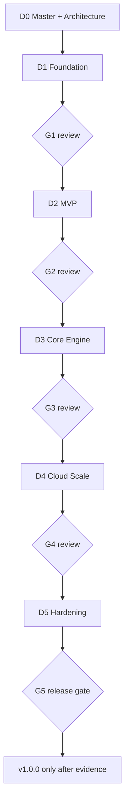

# AetherFlow Suite — Architecture Document v1.0

> وثيقة المعمارية الرسمية. تُقرأ مع `README.md` قبل أي Dossier. هذه وثيقة تصميم وليست إثباتاً بأن التنفيذ أو الأهداف الرقمية قد اجتازت الاختبار.

## 1. نظرة عامة (System Overview)

AetherFlow نظام موزّع لتنسيق معالجة الفيديو والصوت عبر الهاتف وVPS وسحابة اختيارية. المبدأ **Local-First + Smart Offloading**: تُوجّه كل مهمة إلى البيئة المناسبة وفق القواعد والموارد المتاحة وموافقة المستخدم الصريحة قبل نقل الملفات إلى السحابة.



## 2. المكونات (Components)

### 2.1 Orchestrator (VPS)
**الدور:** استقبال المهام، اختيار البيئة، إدارة الطابور والحصص، تسجيل الأحداث وتقديم API.

| المكوّن | المسؤولية | التقنية المقترحة |
|---|---|---|
| `main.py` | REST API والصحة وتدفق SSE | FastAPI |
| `decision_engine.py` | تقييم `rules.yaml` وسياسات الأخطاء | Python + PyYAML |
| `environment_selector.py` | اختيار بيئة متاحة وفق الموارد | Python |
| `queue.py` | طابور دائم مع أولوية | SQLite WAL |
| `quota_manager.py` | حدود 80%/100% ومفاتيح الإيقاف | مهام دورية + SQLite |
| `notifier.py` | إشعارات اختيارية | httpx / Telegram |
| `key_proxy.py` | توجيه طلبات مزودي النماذج | LiteLLM اختياري |

### 2.2 Agent (Phone)
- `agent.py`: واجهة FastAPI على `127.0.0.1:8765` خلف نفق خاص.
- `protocol.py`: نماذج Pydantic لـHeartbeat وProgress.
- `heartbeat.py`: إرسال heartbeat كل 30 ثانية؛ تجاوز 90 ثانية يجعل البيئة offline.
- `executors/`: `whisper.cpp` وFFmpeg فقط على الهاتف وفق قيود الموارد والحرارة.
- `cli.py`: عميل Typer وأوامر التشغيل المحلي والمتصل.

### 2.3 Executors (واجهة موحدة)
```python
from abc import ABC, abstractmethod
from typing import Callable, Any

class Executor(ABC):
    @abstractmethod
    def run(self, job_spec: dict[str, Any], on_progress: Callable[[float], None]) -> dict[str, Any]:
        """تنفيذ المهمة وإرجاع outputs وبيانات وصفية مثل duration_sec."""
        raise NotImplementedError
```

| Executor | البيئة | الاستخدام |
|---|---|---|
| `FFmpegSplitExecutor` | Phone/VPS | تقسيم مع stream copy (`-c copy`) |
| `WhisperCppExecutor` | Phone | تفريغ محلي ARM64 |
| `FasterWhisperExecutor` | VPS/Cloud متوافق | تفريغ صوت |
| `ProPainterExecutor` | VPS-GPU | إزالة نصوص مدمجة بإعادة بناء الخلفية |
| `ModalProPainterExecutor` | Cloud بموافقة | معالجة سحابية قابلة لإعادة المحاولة |

### 2.4 Web UI (HTMX)
`web/templates/` لـJinja2 + HTMX 2، و`web/static/css/` لـCSS/Tailwind، و`web/static/fonts/` للخطوط المحلية. HTMX مناسب لواجهة single-user خفيفة بلا SPA أو build step مع إبقاء متطلبات الوصول والأمان قابلة للاختبار.

## 3. تدفق البيانات (Data Flow)

### 3.1 Happy Path — تفريغ عربي على VPS
1. يرسل المستخدم `POST /jobs` مع نوع المهمة ومسار/مرجع الملف واللغة.
2. يتحقق Orchestrator من المدخلات والصلاحيات، ثم يسجل المهمة `queued` في SQLite.
3. يقيّم Decision Engine اللغة والمدة والذاكرة والحرارة وقدرات البيئات.
4. تُحجز المهمة ذرياً وتُعيّن البيئة المناسبة، مثل `faster-whisper` على VPS.
5. يُحوّل الصوت عند الحاجة إلى WAV أحادي 16kHz، ثم يُنتج SRT/VTT/JSON.
6. تُسجل تحديثات التقدم والأحداث؛ وفي D3 تُبث عبر SSE إلى الواجهة.
7. تُحدّث الحالة إلى `completed` وتُرسل إشعارات اختيارية دون أسرار أو مسارات حساسة.
8. يستعلم المستخدم عن `GET /jobs/{id}` ويحصل على روابط/مسارات المخرجات المصرح بها.
9. تنظف سياسة الاحتفاظ الملفات المؤقتة بعد 24 ساعة افتراضياً، مع حماية المخرجات التي لم تُنزّل إذا تقرر ذلك في التنفيذ.

### 3.2 Failover — ProPainter OOM على VPS
1. تُرسل مهمة `text_removal` مع `cloud_consent: true`.
2. يختار المحرك بيئة GPU محلية عند توافر VRAM كافية.
3. إذا وقع OOM، تُحفظ حالة المقاطع المكتملة ونقطة الاستئناف.
4. تُعاد مراجعة القرار وفق `error_policies.yaml`.
5. لا يحدث توجيه سحابي إلا بعد تحقق `cloud_consent` و`guard_cloud_dispatch` وقيود tier والحصة.
6. تُرسل المقاطع غير المكتملة إلى Modal، ثم تُجمع النتائج وتُفحص قبل اعتبار المهمة ناجحة.
7. تُنظّف الملفات السحابية المؤقتة وفق سياسة احتفاظ قابلة للتحقق.

> الاستئناف الدقيق ودمج التداخلات يتطلبان تنفيذاً واختبارات؛ لا يفترض أن Modal أو ProPainter يحققان ذلك تلقائياً.

### 3.3 Offline Path — CLI `--local`
- يعمل CLI محلياً دون الاعتماد على VPS أو Web UI.
- يختار النموذج وفق RAM والحرارة والتخزين، مع إمكانية رفض المهمة عند عدم كفاية الموارد.
- يستخدم `whisper.cpp` للهاتف، ولا يشغّل `faster-whisper` على الهاتف.
- يجب توضيح ما إذا كانت الحالة والمخرجات تُحفظ محلياً؛ لا يُفترض أن هذا المسار بلا قاعدة بيانات إلا إذا نفّذ ذلك صراحة.

## 4. بروتوكولات الاتصال (Protocols)

### 4.1 User ↔ Orchestrator
- النقل: HTTPS عبر Caddy وTLS.
- المصادقة: `Authorization: Bearer <token>`.
- البيانات: JSON؛ تُوثق واجهات OpenAPI وتتحقق من مخططات الطلبات.
- تحديد المعدل: هدف ابتدائي 10 طلبات/دقيقة للواجهات الحساسة، مع استثناءات موثقة لـSSE والتنزيلات.

### 4.2 Orchestrator ↔ Agent
- النقل: REST عبر SSH tunnel وشبكة خاصة مثل Tailscale؛ لا يُعرّض Agent للعامة.
- المصادقة: `X-Agent-Token` مستقل عن Bearer الخاص بالمستخدم.
- heartbeat: كل 30 ثانية؛ مهلة 90 ثانية قبل اعتبار البيئة offline.
- إعادة الاتصال: autossh/خدمة مشرف مناسبة، مع تدوير وإبطال المفاتيح عند الحاجة.

### 4.3 Orchestrator ↔ Modal
- النقل: HTTPS باستخدام SDK الرسمي وبيانات اعتماد محفوظة في secret store أو متغيرات بيئة محمية.
- شرط الإرسال: `cloud_consent=true`، وسياسة tier تسمح، والحصة والتكلفة ضمن الحدود.
- النقل والتخزين: تجنب تمرير فيديوهات كبيرة في استدعاءات الذاكرة إن كان التخزين المرحلي أكثر أماناً؛ طبّق cleanup واختبره.

### 4.4 Orchestrator ↔ LiteLLM ↔ Providers
- LiteLLM داخلي فقط، مربوط بـlocalhost أو شبكة Docker الخاصة.
- المصادقة الداخلية عبر `LITELLM_MASTER_KEY`، ومفاتيح المزودين لا تظهر في السجلات.
- تناوب المفاتيح وcircuit breaker يُختبران على إصدار مثبت؛ لا تعتمد إعدادات `latest` في الإنتاج.

## 5. نموذج البيانات (Data Model)



### آلة حالات المهمة


يجب توحيد أسماء الحالات في قاعدة البيانات وAPI وواجهة المستخدم. تُنفّذ عملية claim داخل معاملة ذرية، وتُستخدم استعلامات parameterized. SQLite WAL مناسب كبداية single-user، لكنه لا يحوّل SQLite إلى قاعدة متعددة الكتّاب.

## 6. النشر (Deployment Topology)

### 6.1 VPS — البيئة الرئيسية
- نظام مستهدف: Ubuntu 22.04 LTS أو إصدار مدعوم يختبره الفريق.
- خط أساس تخطيطي: 2 vCPU و4GB RAM و40GB SSD؛ المعالجة الثقيلة تحتاج موارد إضافية.
- المنافذ العامة: 80/443 لـCaddy فقط؛ لا يُنشر Uvicorn أو LiteLLM مباشرة.
- الخدمات: Orchestrator، Caddy، LiteLLM اختياري، ونفق Agent كخدمة نظام خارج Compose أو ضمن تصميم موثق.

### 6.2 Phone — Termux
- Android ARM64، ويفضل 4GB RAM أو أكثر مع مساحة حرة كافية.
- Termux وwhisper.cpp وFFmpeg وعميل شبكة خاصة عند دعمها.
- المنفذ 8765 محلي فقط؛ يجب اختبار قيود Android على العمليات الخلفية والحرارة والبطارية.

### 6.3 Cloud — Modal
- مورد GPU عند الطلب؛ نوع GPU والسعر والحصص والتوفر تتغير ويجب التحقق منها وقت التنفيذ.
- لا تفترض رصيداً مجانياً ثابتاً أو سعراً مضموناً.
- تُحذف الملفات والـVolumes المؤقتة وفق سياسة موثقة، مع اختبارات فشل وتنظيف.

## 7. الأمان (Security Layers)

1. **الشبكة:** HTTPS، نفق خاص، وعدم كشف Uvicorn/Agent/LiteLLM للعامة.
2. **المصادقة:** Bearer token للمستخدم، و`X-Agent-Token` للـAgent، ومفتاح LiteLLM داخلي منفصل.
3. **التفويض:** التحقق من ملكية المهمة، وtier، و`cloud_consent`، وحدود الحساب والحصة.
4. **البيانات:** تشفير مفاتيح API، وعدم تسجيل الأسرار أو محتوى الملفات، وسياسة احتفاظ قابلة للتكوين.
5. **التدقيق:** أحداث منظمة، سجلات JSON، تدوير السجلات، وفحوص Bandit وpip-audit وTrivy ضمن CI.

توصيات إضافية: تقييد CORS، تعطيل أو حماية `/docs` في الإنتاج، وضع حدود لحجم الملفات، منع shell injection باستخدام قوائم `subprocess`، والتحقق من المسارات لمنع path traversal. التحقق من MIME وحده غير كافٍ لإثبات سلامة ملف الفيديو.

## 8. أهداف الأداء (Performance Targets)

هذه أهداف قياس وليست نتائج مؤكدة؛ تعتمد على العتاد والملفات والإصدارات.

| العملية | البيئة | الهدف التخطيطي |
|---|---|---:|
| Enqueue | VPS | أقل من 5ms في اختبار محلي مضبوط |
| Dequeue | VPS | أقل من 10ms في اختبار محلي مضبوط |
| Web UI LCP | متصفح مدعوم | أقل من 2.5s |
| SSE latency | شبكة مستقرة | أقل من 500ms مستهدف |
| Heartbeat latency | شبكة مستقرة | أقل من 200ms مستهدف |
| Split لفيديو 30 دقيقة (المسار الكامل مع فحص الفك) | VPS | أقل من 15s مستهدف؛ يُقاس بـ`scripts/benchmark_long_media.sh` |
| Split لفيديو ساعتين (`-c copy`، المسار الكامل مع فحص الفك) | VPS | أقل من 60s مستهدف؛ يعتمد على I/O وkeyframes ويُقاس بنفس السكربت |
| Transcription 30 دقيقة (`small`) | GPU/VPS | يقاس benchmark فعلي؛ لا تعتمد أرقاماً غير معاد إنتاجها |
| ProPainter لفيديو 10 دقائق | Modal GPU | يقاس حسب الدقة والإعدادات والعتاد |

حدود تصميم أولية: SQLite حتى نحو 1000 مهمة نشطة، وSSE حتى 100 اتصال متزامن، و500 مهمة/يوم في استخدام single-user؛ يلزم اختبار حمل قبل اعتمادها كحدود تشغيلية.

## 9. بيئات التشغيل (Environments)

| ID مثال | النوع | المصدر | مراقبة الصحة |
|---|---|---|---|
| `phone-1` | phone | agent | heartbeat كل 30s |
| `vps-1` | vps | agent أو health check محلي | heartbeat/health check |
| `cloud-modal` | cloud | provider API | polling/نتيجة المهمة |
| `cloud-vast` | cloud اختياري | provider API | polling؛ لا يُتاح في tier المجاني |

`source=agent` يعني أن البيئة ترسل heartbeat؛ أما البيئات السحابية فتُراقب عبر API المزود أو حالة الاستدعاء، لا عبر heartbeat الهاتف.

## 10. المراقبة (Observability)



الأحداث المهمة: `job_completed` و`job_failed` و`job_stalled` و`quota_80` و`quota_100` و`agent_offline` و`cloud_forbidden`. يجب ألا تحتوي الإشعارات أو السجلات على tokens أو مفاتيح أو مسارات شخصية كاملة. لا يُعد `/metrics` موجوداً حتى يُنفذ ويُختبر فعلياً.

## 11. قرارات التصميم (ADR)

- **ADR-001 — HTMX بدل SPA:** واجهة single-user خفيفة؛ العاقبة هي اعتماد server-rendered partials واختبار SSE والوصول.
- **ADR-002 — SQLite بدل Postgres:** إعداد وتشغيل أبسط؛ كاتب واحد، لذا يجب اختبار المعاملات والتزامن والنسخ الاحتياطي.
- **ADR-003 — Modal بدل notebooks غير الرسمية:** استخدام واجهة تشغيل مدعومة؛ السعر والحصة والتوفر تُراجع وقت التنفيذ.
- **ADR-004 — ProPainter لإزالة النصوص:** يتطلب GPU واختبار جودة وترخيص النموذج والأوزان؛ النتيجة ليست مضمونة لكل مشهد.
- **ADR-005 — `rules.yaml` بدل قواعد مدفونة في الكود:** قابل للمراجعة؛ يتطلب schema validation واختبارات fallback.
- **ADR-006 — Tailscale/SSH خاص بدل SSH عام:** يقلل سطح الهجوم؛ يحتاج إدارة مفاتيح وإبطالاً ومراقبة.
- **ADR-007 — chunking مع overlap:** قد يقلل عيوب الحدود؛ يلزم اختبار دمج ومزامنة وتكلفة الذاكرة، ولا يضمن إزالة كل الآثار.

## 12. مخططات التسلسل (Sequence Diagrams)

### 12.1 إرسال مهمة ومتابعة SSE


### 12.2 Heartbeat وtimeout


## 13. العلاقات بين Dossiers



الاعتماديات: D2 يحتاج schemas والقواعد من D1؛ D3 يحتاج Orchestrator والطابور من D2؛ D4 يحتاج Agent وExecutors من D3؛ D5 يختبر النظام المتكامل من D1 إلى D4. لا تُعتبر أي بوابة ناجحة بمجرد وجود الوثائق.

## 14. قائمة تحقق المعمارية

- [ ] لكل مكون مسؤولية واضحة وحدود اعتماد موثقة.
- [ ] بروتوكولات المصادقة وتنسيقات البيانات مختبرة.
- [ ] آلة الحالات موحدة بين قاعدة البيانات وAPI وExecutors.
- [ ] لا يُرفع ملف إلى السحابة دون موافقة صريحة وتحقق tier.
- [ ] الأهداف الرقمية مقاسة باختبارات قابلة لإعادة الإنتاج.
- [ ] النسخ الاحتياطي والاستعادة مجرّبان على بيئة staging.
- [ ] اختبارات الأمن وإمكانية الوصول نُفذت فعلياً.
- [ ] الأسرار لا تظهر في Git أو logs أو إشعارات Telegram.
- [ ] تراخيص الشيفرة والنماذج والأوزان موثقة قبل التوزيع.

**الإصدار:** v1.0 blueprint  
**آخر تحديث:** 2026  
**الرخصة المقترحة:** MIT، مع ضرورة مراجعة تراخيص المكونات الخارجية بصورة مستقلة.  
**الحالة:** وثيقة تصميم؛ ليست اعتماداً إنتاجياً ولا دليلاً على اجتياز الاختبارات.
